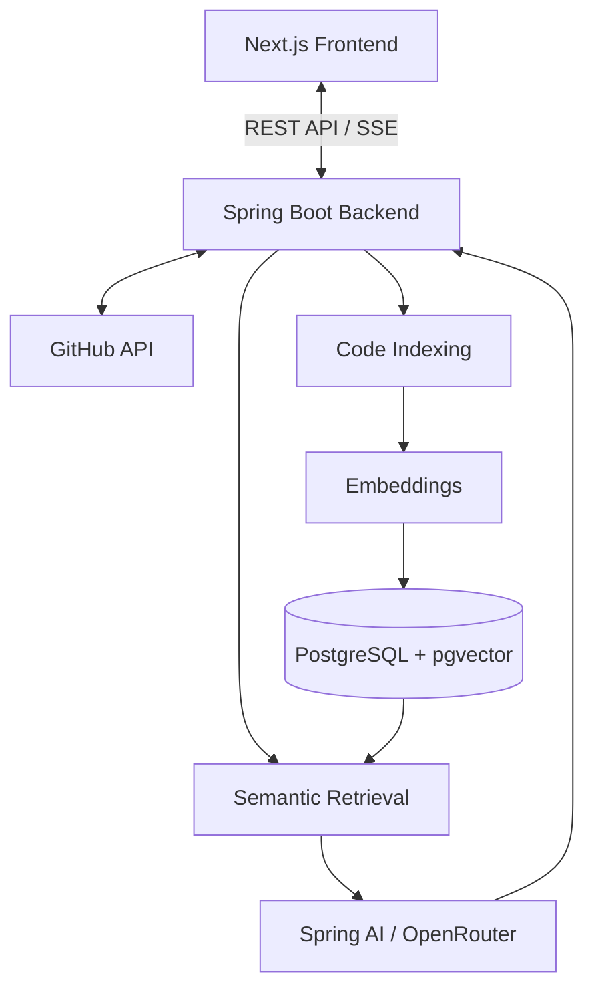

# DevPilot

**An AI-powered GitHub repository assistant that helps developers understand their codebase through context-aware chat and source citations.**


## Overview

DevPilot connects to GitHub repositories, indexes source code, and lets developers ask questions about their implementation using AI.

It uses **Retrieval-Augmented Generation (RAG)** to retrieve relevant code context before generating answers, helping developers explore unfamiliar codebases with source citations.

## Features

- **GitHub OAuth** — Authenticate and access repositories permitted by your authorization.
- **Repository indexing** — Fetch source files, split code into chunks, and generate embeddings.
- **Semantic code search** — Retrieve relevant code using PostgreSQL and pgvector.
- **AI-powered chat** — Ask natural-language questions about an indexed repository.
- **Streaming responses** — Receive answers in real time using Server-Sent Events (SSE).
- **Source citations** — Trace answers to relevant files and line ranges when available.
- **Persistent chat sessions** — Create conversations and revisit previous messages.
- **Indexing status** — Track repository indexing progress.

## Tech Stack

| Layer | Technologies |
|---|---|
| Frontend | Next.js 16, React 19, TypeScript |
| Styling | Tailwind CSS 4 |
| Backend | Java 21, Spring Boot 4 |
| AI integration | Spring AI, OpenRouter |
| Database | PostgreSQL 16, pgvector |
| Persistence | Spring Data JPA, Hibernate |
| Authentication | GitHub OAuth 2.0 |
| Infrastructure | Docker Compose |

## Architecture



## How It Works

1. Sign in with GitHub and select a repository.
2. Index the repository's supported source files.
3. DevPilot splits the code into chunks and stores their embeddings in pgvector.
4. Ask a question about the indexed codebase.
5. DevPilot retrieves relevant code context and sends it to the configured AI model.
6. Receive a streamed answer with source citations when available.

## Project Structure

```text
devPilot/
├── backend/              # Spring Boot API and AI services
├── client/               # Next.js frontend
├── docker/
│   └── postgres/         # PostgreSQL initialization
├── docker-compose.yml
└── README.md
```

## Getting Started

### Prerequisites

- Java 21
- Node.js 20+ and npm
- Docker Desktop with Docker Compose
- GitHub OAuth application credentials
- OpenRouter API key or another compatible AI provider

### 1. Clone the repository

```bash
git clone https://github.com/Aestheticsuraj234/devPilot.git
cd devPilot
```

### 2. Configure environment variables

Create a `.env` file in the repository root:

```dotenv
POSTGRES_DB=devpilot
POSTGRES_USER=postgres
POSTGRES_PASSWORD=your-database-password

DB_URL=jdbc:postgresql://localhost:5433/devpilot
DB_USERNAME=postgres
DB_PASSWORD=your-database-password

TOKEN_ENCRYPTOR_PASSWORD=your-encryption-secret
TOKEN_ENCRYPTOR_SALT=your-encryption-salt

OPENAI_API_KEY=your-openrouter-api-key
OPENAI_CHAT_MODEL=openai/gpt-4.1-mini

GITHUB_CLIENT_ID=your-github-client-id
GITHUB_CLIENT_SECRET=your-github-client-secret
```

Configure the GitHub OAuth callback URL as:

```text
http://localhost:8080/login/oauth2/code/github
```

Ensure the environment variable names match the backend configuration. Never commit real credentials or secrets.

### 3. Start the database

From the repository root:

```bash
docker compose up -d postgres
```

### 4. Start the backend

On Windows PowerShell:

```powershell
cd backend
.\mvnw.cmd spring-boot:run
```

On macOS or Linux:

```bash
cd backend
./mvnw spring-boot:run
```

Backend URL: `http://localhost:8080`

### 5. Start the frontend

Open another terminal:

```bash
cd client
npm install
```

Create `client/.env.local`:

```dotenv
NEXT_PUBLIC_API_BASE_URL=http://localhost:8080
```

Start the development server:

```bash
npm run dev
```

Open **http://localhost:3000** to use DevPilot.

## Useful Commands

| Command | Purpose |
|---|---|
| `npm run dev` | Start the frontend |
| `npm run build` | Build the frontend |
| `npm run lint` | Lint the frontend |
| `.\mvnw.cmd test` | Run backend tests on Windows |
| `docker compose down` | Stop local services |

