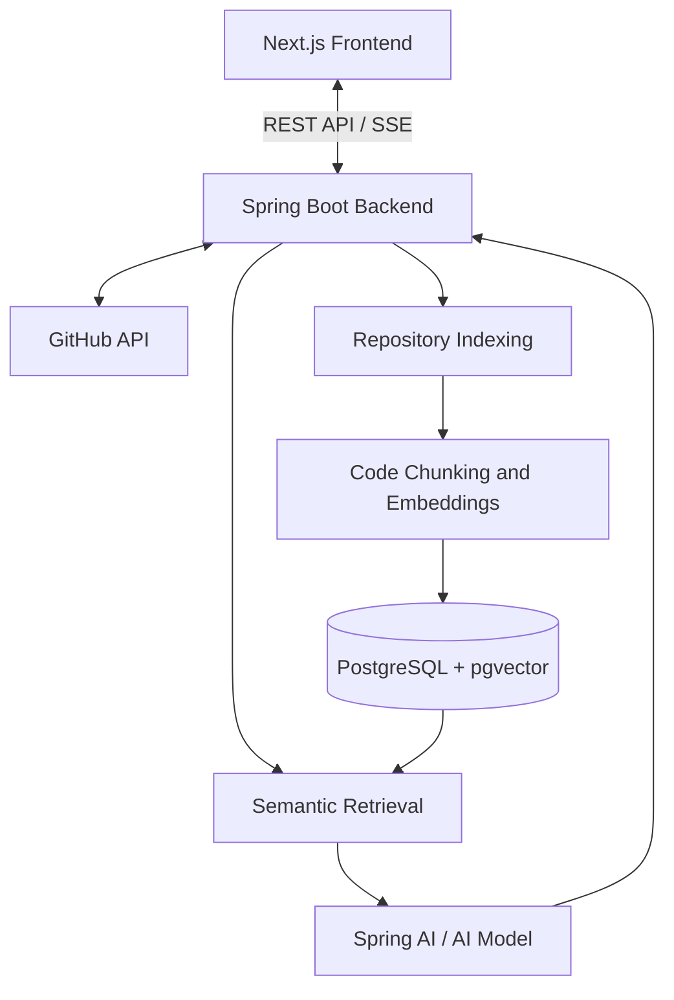

# DevPilot

**An AI-powered GitHub repository assistant for exploring codebases through context-aware chat and source citations.**


## Overview

DevPilot connects to GitHub repositories, indexes their source code, and lets developers ask natural-language questions about their implementation.

Using Retrieval-Augmented Generation (RAG), DevPilot retrieves relevant code context before generating an answer. Responses are streamed in real time and include source citations when available, making it easier to understand unfamiliar codebases.

## Features

- **GitHub OAuth authentication**
  - Sign in with GitHub.
  - Access repositories permitted by the OAuth authorization.

- **Repository discovery**
  - Retrieve repositories associated with the authenticated GitHub account.
  - View repository metadata and indexing status.

- **Asynchronous repository indexing**
  - Fetch source files through the GitHub API.
  - Filter unsupported and oversized files.
  - Split source code into searchable chunks.
  - Generate and store vector embeddings.

- **Semantic code search**
  - Search indexed code using PostgreSQL and `pgvector`.
  - Retrieve context relevant to each user question.

- **AI-powered chat**
  - Ask natural-language questions about an indexed repository.
  - Generate answers using Spring AI and an OpenAI-compatible chat model.

- **Streaming responses**
  - Receive assistant responses progressively using Server-Sent Events (SSE).

- **Source citations**
  - Reference relevant files, line ranges, and programming languages when available.

- **Persistent chat sessions**
  - Create conversations for indexed repositories.
  - Store and revisit previous messages.

- **Indexing progress**
  - Track files processed, chunks created, completion status, and indexing errors.

## Tech Stack

| Layer | Technologies |
| --- | --- |
| Frontend | Next.js 16, React 19, TypeScript |
| Styling | Tailwind CSS 4 |
| Backend | Java 21, Spring Boot 4.1 |
| AI integration | Spring AI 2.0, OpenAI-compatible chat model |
| Database | PostgreSQL 16, pgvector |
| Persistence | Spring Data JPA, Hibernate |
| Authentication | GitHub OAuth 2.0 |
| Communication | REST API and Server-Sent Events |
| Infrastructure | Docker Compose |
| Build tools | Maven and npm |

## Architecture



## How It Works

1. Authenticate with GitHub.
2. Select a repository from the connected GitHub account.
3. Start repository indexing.
4. DevPilot fetches supported source files from GitHub.
5. Files are split into chunks and stored as vector embeddings.
6. Create a chat session for the indexed repository.
7. Ask a question about the codebase.
8. DevPilot retrieves relevant code context.
9. The configured AI model generates a grounded response.
10. The answer is streamed to the frontend with citations when available.

## Project Structure

```text
devPilot/
├── backend/
│   ├── src/
│   │   ├── main/
│   │   │   ├── java/
│   │   │   │   └── devPilot/backend/
│   │   │   │       ├── config/
│   │   │   │       ├── controllers/
│   │   │   │       ├── dto/
│   │   │   │       ├── entity/
│   │   │   │       ├── repository/
│   │   │   │       ├── security/
│   │   │   │       └── services/
│   │   │   └── resources/
│   │   └── test/
│   ├── pom.xml
│   ├── mvnw
│   └── mvnw.cmd
│
├── client/
│   ├── app/                  # Next.js routes and pages
│   ├── components/           # UI and feature components
│   ├── hooks/                # React hooks
│   ├── lib/                  # API client and shared utilities
│   ├── public/               # Static assets
│   └── package.json
│
├── docker/
│   └── postgres/             # PostgreSQL initialization scripts
│
├── docker-compose.yml
└── README.md
```

## Getting Started

### Prerequisites

Install the following before running DevPilot locally:

- Java Development Kit 21
- Node.js and npm
- Docker Desktop with Docker Compose
- A GitHub OAuth application
- An API key for the configured OpenAI-compatible AI provider

### 1. Clone the repository

```bash
git clone https://github.com/Aestheticsuraj234/devPilot.git
cd devPilot
```

### 2. Start PostgreSQL and pgvector

From the repository root:

```bash
docker compose up -d postgres
```

The local database is exposed on port `5433`.

Default development connection details:

```text
Host: localhost
Port: 5433
Database: devpilot
Username: postgres
Password: postgres
```

The Docker Compose configuration uses the `pgvector/pgvector:pg16` image and initializes the required PostgreSQL extensions.

> The included database credentials are for local development only. Use secure credentials in shared or production environments.

### 3. Configure the backend

Configure the backend using your Spring Boot configuration file or environment-specific configuration.

The following application properties are required by the project:

```properties
# Frontend and CORS
app.frontend-url=http://localhost:3000
app.cors.allowed-origins=http://localhost:3000

# Encryption used for stored GitHub access tokens
app.token-encryptor-password=replace-with-a-secure-local-secret
app.token-encryptor-salt=replace-with-a-secure-salt

# GitHub API behavior
app.github.api-delay-ms=50

# Repository indexing
app.indexing.chunk-size=800
app.indexing.max-file-bytes=102400
```

Configure the database connection:

```properties
spring.datasource.url=jdbc:postgresql://localhost:5433/devpilot
spring.datasource.username=postgres
spring.datasource.password=postgres
```

Configure GitHub OAuth and Spring AI according to your environment. Do not commit real credentials or secrets.

A local GitHub OAuth application should use the following callback URL:

```text
http://localhost:8080/login/oauth2/code/github
```
#### AI provider

DevPilot uses Spring AI's OpenAI-compatible chat model integration.

For OpenAI:

```properties
spring.ai.openai.api-key=your-openai-api-key
spring.ai.openai.chat.options.model=your-chat-model
```

### 4. Start the backend

On macOS or Linux:

```bash
cd backend
./mvnw spring-boot:run
```

On Windows PowerShell:

```powershell
cd backend
.\mvnw.cmd spring-boot:run
```

The backend runs at:

```text
http://localhost:8080
```

### 5. Configure and start the frontend

Open a separate terminal:

```bash
cd client
npm install
```

Create `client/.env.local`:

```env
NEXT_PUBLIC_API_BASE_URL=http://localhost:8080
```

Start the development server:

```bash
npm run dev
```

Open the application at:

```text
http://localhost:3000
```

## Usage

1. Open DevPilot in your browser.
2. Select **Continue with GitHub**.
3. Authorize the GitHub OAuth application.
4. Choose a repository.
5. Start indexing.
6. Wait until the repository status is `READY`.
7. Create a chat session.
8. Ask questions about the codebase.
9. Review the generated answer and available source citations.

A repository must be successfully indexed before it can be used for chat.

## API Overview

The frontend communicates with the backend through REST endpoints and Server-Sent Events.

| API area | Purpose |
| --- | --- |
| `/api/auth` | Authentication, current-user information, and logout |
| `/api/repos` | Repository listing, details, indexing, and status |
| `/api/chat/sessions` | Chat session creation and history |
| Chat streaming endpoint | Streams assistant messages and citations over SSE |

Protected `/api` endpoints require an authenticated session.

## Useful Commands

### Frontend

Run these commands from the `client` directory:

| Command | Description |
| --- | --- |
| `npm run dev` | Start the Next.js development server |
| `npm run build` | Create a production frontend build |
| `npm run start` | Start the production frontend server |
| `npm run lint` | Run ESLint |

### Backend

Run these commands from the `backend` directory:

| Command | Description |
| --- | --- |
| `./mvnw spring-boot:run` | Start the Spring Boot application |
| `./mvnw test` | Run backend tests |
| `./mvnw clean package` | Clean and package the backend |

On Windows, use `mvnw.cmd` instead of `./mvnw`.

### Infrastructure

Run these commands from the repository root:

| Command | Description |
| --- | --- |
| `docker compose up -d postgres` | Start PostgreSQL with pgvector |
| `docker compose down` | Stop local services |
| `docker compose logs -f postgres` | Follow PostgreSQL logs |

## Testing

Run backend tests:

```bash
cd backend
./mvnw test
```

On Windows:

```powershell
cd backend
.\mvnw.cmd test
```

Run frontend linting:

```bash
cd client
npm run lint
```

Create a production frontend build:

```bash
cd client
npm run build
```

## Production Considerations

Before deploying DevPilot to a shared or production environment:

- Replace the default PostgreSQL credentials.
- Use a secure secrets manager for OAuth credentials and API keys.
- Generate strong token-encryption passwords and salts.
- Restrict `app.cors.allowed-origins` to trusted frontend domains.
- Use HTTPS for frontend, backend, OAuth, and SSE traffic.
- Do not expose PostgreSQL publicly unless required.
- Review GitHub OAuth permissions carefully.
- Monitor GitHub API rate limits.
- Configure database backups and persistent storage.
- Use production-specific Spring Boot and Next.js configuration.

## Contributing

Contributions are welcome.

1. Fork the repository.
2. Create a feature branch:

   ```bash
   git checkout -b feature/your-feature
   ```

3. Make your changes.
4. Run the relevant tests, build commands, and linters.
5. Commit your changes with a clear message.
6. Push your branch.
7. Open a pull request describing the change.

Please avoid committing credentials, generated files, local environment files, or production configuration.

## Security

If you discover a security vulnerability, please avoid opening a public issue with sensitive details. Contact the repository maintainer privately with the relevant information and reproduction steps.

## License

No license file is currently included in this repository. Until a license is added, the project should not be assumed to be available for redistribution, modification, or commercial use.

## Acknowledgements

DevPilot is built with:

- [Next.js](https://nextjs.org/)
- [React](https://react.dev/)
- [Spring Boot](https://spring.io/projects/spring-boot)
- [Spring AI](https://spring.io/projects/spring-ai)
- [PostgreSQL](https://www.postgresql.org/)
- [pgvector](https://github.com/pgvector/pgvector)
- [Docker](https://www.docker.com/)
- [GitHub OAuth](https://docs.github.com/en/apps/oauth-apps)